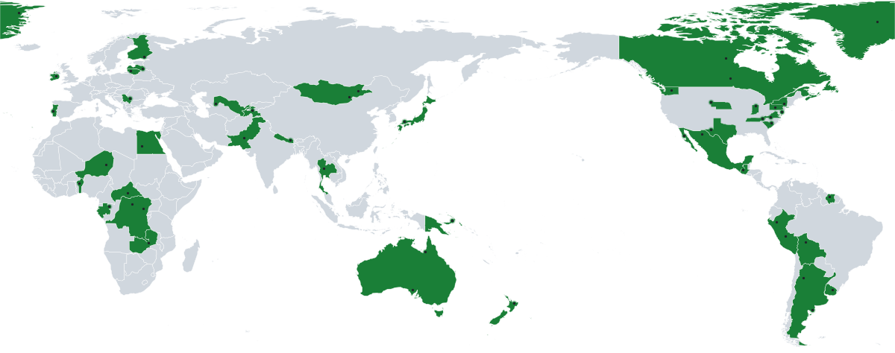
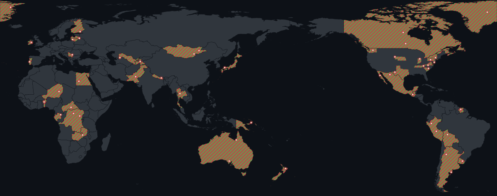
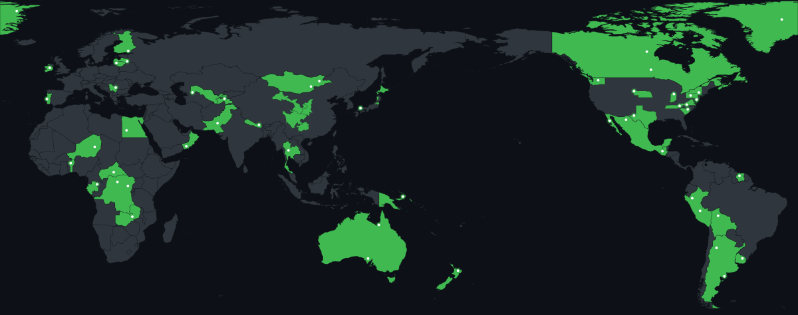

# travel-footprint


<picture>
  <source media="(prefers-color-scheme: dark)" srcset="demo/travel-map.png" />
  <source media="(prefers-color-scheme: light)" srcset="demo/travel-map-light.png" />
  
</picture>

A Pacific-centred world map of countries, US states, Chinese provinces, Japanese prefectures, and cities, drawn for a profile README.

*Reusable GitHub Action and Python CLI. One dark map and one light map, from a YAML file you keep in the repo. PNG by default; the same map can be written as SVG. A stats badge is written next to the map unless you turn it off.*

The preview above is fictional. `scripts/make_demo.py` rebuilds it from a fixed random seed: countries spread across every continent, a handful of US states, a few Chinese provinces and Japanese prefectures, and city dots inside those shapes. It also marks one US state and one city as planned. Those two are drawn, and in the SVG they pulse, but they are not counted as visited and they are not included in the stats badge. It is not a real itinerary. Disputed territories, and a fixed list of sensitive countries in that script, are left out. The sample also skips Xinjiang, Tibet, and Inner Mongolia. The same command also writes `demo/travel-badge.svg` from that config, `demo/travel-map-christmas.png`, and SVG copies of each map: `demo/travel-map.svg`, `demo/travel-map-light.svg`, and `demo/travel-map-christmas.svg`. In the SVGs the planned state and city pulse; the PNGs keep them static.





See [CHANGELOG.md](CHANGELOG.md) for the history of this action.

## Use it

Put `travel.yml` in the repository (start from [`travel.example.yml`](travel.example.yml)), then generate the map next to a [contrib-tetris](https://github.com/KenYanL/contrib-tetris) graph and publish both from `dist/`:

```yaml
name: Publish profile graphics

on:
  schedule:
    - cron: "41 7 * * *"
  workflow_dispatch:

permissions:
  contents: write

jobs:
  generate:
    runs-on: ubuntu-latest
    steps:
      - uses: actions/checkout@v4

      - uses: KenYanL/contrib-tetris@v1
        with:
          github_user_name: ${{ github.repository_owner }}
          svg_light_path: dist/tetris-contrib.svg
          svg_dark_path: dist/tetris-contrib-dark.svg
          palette: auto

      - uses: KenYanL/travel-footprint@v1
        with:
          config: travel.yml
          output: dist
          palette: auto
          badge: true

      - name: Publish to the output branch
        uses: crazy-max/ghaction-github-pages@v5
        with:
          target_branch: output
          build_dir: dist
        env:
          GITHUB_TOKEN: ${{ secrets.GITHUB_TOKEN }}
```

The map files land at the root of `output` as `travel-map.png` (dark) and `travel-map-light.png` (light). Omit `format` to keep that PNG pair. Set `format` to `svg` to write `travel-map.svg` and `travel-map-light.svg` instead, or `both` to write the PNGs and the SVGs. Embed the PNGs with:

```html
<picture>
  <source media="(prefers-color-scheme: dark)" srcset="https://raw.githubusercontent.com/YOUR_USERNAME/YOUR_REPO/output/travel-map.png" />
  <source media="(prefers-color-scheme: light)" srcset="https://raw.githubusercontent.com/YOUR_USERNAME/YOUR_REPO/output/travel-map-light.png" />
  
</picture>
```

`travel-map.png` is the dark map. The light map is `travel-map-light.png`. The SVG names follow the same pattern: `travel-map.svg` and `travel-map-light.svg`. Embed those the same way, with a `.svg` path, when `format` is `svg` or `both`.

`badge: true` is the default, so the step also writes `travel-badge.svg`. Set `badge` to `false` to skip that file. The map files are the same either way. Embed the badge with:

```html

```

### Stats badge

`travel-badge.svg` is a small shield drawn in the palette used for that run. It is one SVG file, with no images, no embedded font file, and no network request. The label is `visited`. The value line shows:

- countries visited
- that count as a percent of the countries the map can draw (every Natural Earth admin-0 country except Antarctica), to the nearest tenth
- US states visited, including zero
- China provinces, only when those units are drawn
- Japan prefectures, only when those units are drawn

Planned states and planned cities are drawn on the map and left out of every badge count. Adding them does not change `travel-badge.svg`.

US states stay on the badge even when the count is zero. China provinces and Japan prefectures are left off until at least one is drawn. Listing `China` or `Japan` under `countries` fills that whole country, so the province or prefecture count is left off, the same way the map does not draw those units on top. Listing `USA` fills the whole country and the badge shows `0 US states`. `palette: auto` colors the badge with the same concrete palette as the map. The badge uses the dark-theme palette colors, because the shield has its own background:

| Palette | Label | Value |
| --- | --- | --- |
| `default` | `#0d1117`, white text | `#3fb950`, white text |
| `halloween` | `#0d1117`, `#e3d04f` text | `#c46212`, white text |
| `christmas` | `#6a994e`, `#f2e8cf` text | `#bc4749`, `#f2e8cf` text |

Halloween keeps the yellow dot color on the short label and uses white on the orange value so the longer line stays readable. Christmas uses the stripe green, the visited red, and the cream dot.

### Inputs

| Input | Required | Default | Description |
| --- | --- | --- | --- |
| `config` | no | `travel.yml` | YAML file of countries, US states, Chinese provinces, Japanese prefectures, cities, and optional planned places. |
| `output` | no | `dist` | Directory for the map files and, when enabled, the badge. |
| `palette` | no | `default` | `default`, `halloween`, `christmas`, or `auto`. |
| `format` | no | `png` | `png`, `svg`, or `both`. |
| `badge` | no | `true` | `true` writes `travel-badge.svg`. `false` skips it. |

`auto` uses the Halloween colors on 31 October (UTC), the Christmas colors on 24, 25, and 26 December (UTC), and the green map every other UTC day. The same rule as contrib-tetris. Omit `palette` to keep the green map on every day, including those holidays.

`format` chooses the files. `png` writes the two PNGs. `svg` writes the two SVGs. `both` writes all four. Omit `format` to keep writing only the two PNGs. Omit `badge` to write the stats badge as well. `badge: false` writes the maps and no badge.

Invalid values fail the step before any map is written. The message names the field and a valid example.

### Outputs

| Output | Description |
| --- | --- |
| `map_dark_path` | Path of `travel-map.png`, when `format` is `png` or `both`. |
| `map_light_path` | Path of `travel-map-light.png`, when `format` is `png` or `both`. |
| `map_dark_svg_path` | Path of `travel-map.svg`, when `format` is `svg` or `both`. |
| `map_light_svg_path` | Path of `travel-map-light.svg`, when `format` is `svg` or `both`. |
| `badge_path` | Path of `travel-badge.svg`, when `badge` is `true`. |

The action installs its Python dependencies into a virtualenv on the runner, then runs `travel_footprint.py`. Map data ships inside the action, so the step does not download Natural Earth.

## Config

`travel.yml` is a mapping with seven keys. Leave a key out, or use an empty list, when you have nothing to draw for it. `planned` and `planned_states` are optional. Configs that omit them render as before.

```yaml
countries:
  - IS
  - NZ
  - Chile
us_states:
  - Colorado
  - ME
china_provinces:
  - Zhejiang
  - Sichuan
japan_prefectures:
  - Kyoto
  - Hokkaido
cities:
  - name: Sample Harbor
    lat: 64.15
    lon: -21.95
planned_states:
  - OR
planned:
  - name: Sample Cove
    lat: 44.00
    lon: -120.50
```

| Key | What it draws |
| --- | --- |
| `countries` | The whole country in the visited color. ISO 3166-1 alpha-2, alpha-3, or an English name (`NZ`, `NZL`, `New Zealand`). `UK` and `US` are accepted. |
| `us_states` | Only those states, in the visited color. The rest of the United States stays plain land. A name or USPS code (`Wyoming`, `WY`). The District of Columbia is accepted. |
| `china_provinces` | Only those units, in the visited color. The rest of China stays plain land. A province, autonomous region, or municipality name, or an ISO 3166-2 code (`Zhejiang`, `CN-ZJ`, `Beijing`, `Inner Mongolia`). |
| `japan_prefectures` | Only those prefectures, in the visited color. The rest of Japan stays plain land. A name or an ISO 3166-2 code (`Kyoto`, `JP-26`, `Tokyo`, `Hokkaido`). Hokkaido, Tokyo, Kyoto, and Osaka are included. |
| `cities` | A dot at `lat`/`lon` (or `latitude`/`longitude`). Longitude is −180 to 180, latitude −90 to 90. |
| `planned_states` | US states you have not visited, drawn in the palette accent at about 40% opacity with a dashed outline. A name or USPS code. Not counted as visited. |
| `planned` | Cities you have not visited, same shape as `cities`. A solid accent dot. Not counted as visited. |

Listing `USA`, `China`, or `Japan` under `countries` fills that whole country, and the matching subdivision list is not drawn on top of it. Listing states, provinces, or prefectures alone does not tint the rest of that country. A state listed under both `us_states` and `planned_states` is rejected, and so is a city listed under both `cities` and `planned`: each place is either visited or planned. A repeated place, an unknown name, a coordinate out of range, or an unknown key fails with a message that quotes the entry and, when a name is close, suggests it. Two-letter codes can stay unquoted: the loader does not read `NO` as a boolean. Other countries' subdivisions are not supported yet.

Planned places are painted only as pending. They stay out of the visited country, state, and city sets, so they do not change visited counts or the stats badge. The SVG animates them with SMIL on a 1.8s loop: the `planned-states` group fades between opacity 0.25 and 0.6, and each planned city (`planned-` plus the name, with spaces turned into hyphens) has an expanding ring and a pulsing dot. PNG shows the same fill and dot without that animation. The accent color is the palette's visited color for the theme, so the default map uses `#3fb950` on the dark theme and `#1a7f37` on the light theme, Halloween uses `#c46212`, and Christmas uses `#bc4749`.

## Palettes

The dark map uses the GitHub dark canvas `#0d1117`, land `#30363d`, and a border in the canvas color. The light map uses white, land `#d0d7de`, and the same layout. Default and Halloween city dots on the light map are `#1f2328` so they stay visible. Christmas dots stay `#f2e8cf` on both themes; they sit on the red and green bands.

| Palette | Theme | Visited | Dots |
| --- | --- | --- | --- |
| `default` | dark | `#3fb950`, solid | `#ffffff` |
| `default` | light | `#1a7f37`, solid | `#1f2328` |
| `halloween` | dark | `#c46212`, solid | `#e3d04f` |
| `halloween` | light | `#c46212`, solid | `#1f2328` |
| `christmas` | dark | `#bc4749` with `#6a994e` diagonal stripes | `#f2e8cf` |
| `christmas` | light | `#bc4749` with `#6a994e` diagonal stripes | `#f2e8cf` |

Halloween colors are GitHub Primer `@primer/primitives` 11.10.0 (`--contribution-halloween` on the dark theme). Christmas colors are [Coolors' most popular Christmas palette](https://coolors.co/palettes/popular/christmas) (`386641`, `6a994e`, `a7c957`, `f2e8cf`, `bc4749`). The stripes are 8 pixels wide at the map's resolution, half red and half green, clipped to the visited shapes. In the SVG those stripes are a pattern, still `#bc4749` under `#6a994e`, with the same 8px period and `#f2e8cf` dots. Default and Halloween stay solid fills. Provinces and prefectures use the same fill as countries and US states for the palette you pick. Planned states and cities use that same accent, not a separate palette: a translucent fill and dashed outline for states, and a solid dot for cities. Only the SVG animates them.

## How it is drawn

Natural Earth, plate carrée, seam at 30°W. Land west of that line is shifted by 360° so the Pacific sits in the middle and the Americas sit on the right. Antarctica is omitted. Countries are simplified slightly, then painted as plain land. A country listed under `countries` is filled in full. A listed US state, Chinese province, or Japanese prefecture is filled on its own; the rest of that country is left as land. Christmas then lays diagonal stripes over those visited shapes. City dots sit on top, with a soft halo. Planned states and cities are painted after that, in the accent color, and they are not part of the visited shapes. Each PNG is 1200×474. The SVG uses that same frame as its viewBox, the same projection, and the same fills, and it is the only output that runs the planned pulse.

Countries and the 1:50m admin-1 file (US states and Chinese provinces) are the unmodified Natural Earth zips in [`travel_footprint/data/`](travel_footprint/data/README.md), public domain, checked against `travel_footprint/data/SHA256SUMS`. Japanese prefectures are a public-domain extract of Natural Earth 1:10m admin-1, because the 1:50m admin-1 theme does not include Japan. If a 1:50m zip is missing, the CLI downloads it once into `TRAVEL_FOOTPRINT_CACHE`, or `$XDG_CACHE_HOME/travel-footprint`, or `~/.cache/travel-footprint`, and checks the hash before drawing. The Japan extract ships with the repository. An installed copy finds those same files in `data/` next to the library.

## Develop

Python 3.10 or newer.

This project is not published on PyPI. From a clone, `python3 -m pip install .` (or `python3 -m pip install -e .` for an editable install) provides the `travel-footprint` command. `travel-footprint --help` uses the same flags as `python3 travel_footprint.py`. The GitHub Action does not install the package; it still runs `travel_footprint.py`.

```bash
python3 -m pip install -r requirements.txt pytest
python3 -m pytest
python3 -m pip install .
python3 travel_footprint.py --config travel.example.yml --out dist --palette default
python3 travel_footprint.py --config travel.yml --out dist --palette auto --date 2026-12-25
python3 travel_footprint.py --config travel.example.yml --out dist --format both
python3 travel_footprint.py --config travel.example.yml --out dist --badge false
python3 scripts/make_demo.py
```

`--palette` is the same choice as the action input. `--date` is the UTC day used when the palette is `auto`. Halloween is 31 October. Christmas is 24, 25, and 26 December. `--format` is `png` (the default), `svg`, or `both`. `--badge` is `true` (the default) or `false`. `true` writes `travel-badge.svg` next to the map.

[`.github/workflows/test.yml`](.github/workflows/test.yml) runs the tests, and checks that `python -m build` produces an sdist and a wheel, on pull requests and on pushes to `main`. Nothing is uploaded.

## License

[MIT](LICENSE).

Map data is public domain [Natural Earth](https://www.naturalearthdata.com/about/terms-of-use/), version 5.1.1, including the Japan prefecture extract. See [`travel_footprint/data/README.md`](travel_footprint/data/README.md).
